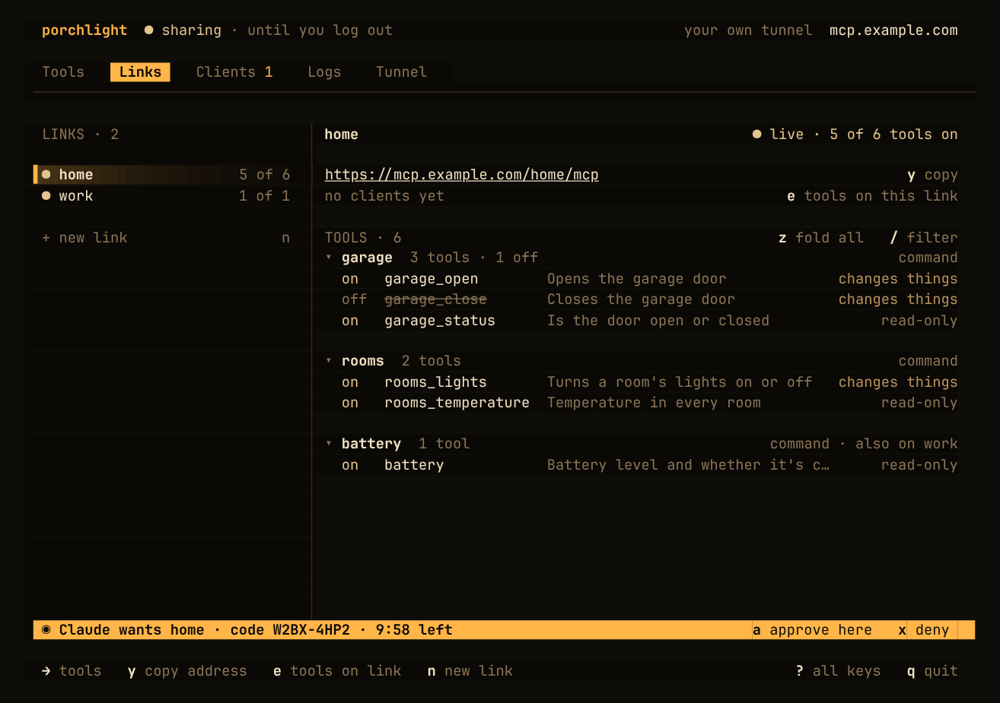

# porchlight

A small [CLI + terminal app](#the-cli) and [AI skill](#the-skill) that shares the command-line tools and MCP servers on your computer with MCP clients like Claude, over HTTPS.

porchlight turns `df -h`, a backup script or a local MCP server into tools that a remote client can call. Nothing is reachable until a person at your computer approves the client.



## Features

- **One command per tool**: `porchlight tools add disk -- df -h`. Everything after `--` is the command, word for word, with no shell.
- **You approve every client**: a client that asks to connect gets nothing until you type porchlight's code on its device.
- **Links per audience**: put your home tools on one address and your work tools on another. Each MCP server gets its own.
- **Safe by default**: commands that hand input to a shell are refused, every tool can be switched off, and every call is logged.
- **Agent-friendly**: every command takes `--json`, has examples in `--help`, and the [skill](#the-skill) teaches agents the workflow.
- **No account needed**: [OpenTunnel](https://github.com/anomalyco/opentunnel) gives you a public address, or bring your own domain ([tunnels](skills/porchlight/references/tunnels.md)).

## Installation

```bash
$ curl -fsSL https://github.com/mahali00/porchlight/releases/latest/download/install.sh | sh
$ npx skills add mahali00/porchlight
```

macOS and Linux. The installer checks the download's checksum, and its build attestation when the GitHub CLI (`gh`) is installed. The second line is optional: it gives your coding agent the [skill](#the-skill).

## How it works

**1. Share a tool.** Wrap any program. A `{name}` becomes an input the client fills in:

```bash
$ porchlight tools add disk --read-only -d "Free disk space" -- df -h
$ porchlight tools add weather --read-only -d "Weather for a city" -- curl -s "wttr.in/{city}?format=3"
$ porchlight servers add files -- npx -y @modelcontextprotocol/server-filesystem ~/Documents
$ porchlight servers import          # lists the MCP servers Claude, Cursor and VS Code already use
```

A command that deletes or overwrites things, like `rm {path}`, is never marked read-only, and clients are told it's destructive. When a client chooses its input, a person has to confirm it in a terminal. No input can contain `..`, so `rm ~/Downloads/{name}` can't reach outside `~/Downloads`.

**2. Start sharing.** porchlight opens the tunnel and keeps running in the background:

```bash
$ porchlight start
$ porchlight links list
● tools        https://porchlight.k2x9.opentunnel.xyz/tools/mcp
  disk, weather · 2 of 2 tools on · no clients
```

**3. Approve the client.** Add the address to your MCP client as a remote MCP server. It opens a page that asks for a code. porchlight shows that code on your computer: in a notification, in the app under Clients, on the home page, or with `porchlight approve`. Type it on the page, whether the client runs on this computer, a phone or another laptop:

```bash
$ porchlight approve
Code for Claude on tools: EEXR-YFWK
Type it on the device that's connecting. It expires in 9:41.
```

A wrong code keeps the page open and says how many tries are left; after five, the request ends. Only a person at your computer can see the code. Agents and scripts can do everything else.

TL;DR:
- Tools are programs you already trust, run as you, without a shell. Each input is one argument.
- A link is an address plus the tools on it. Change a link's tools and its clients approve again.
- `porchlight logs` shows every call, `tools disable` turns any tool off, and `clients revoke` takes access away.

## The CLI

Every action in the terminal app (`porchlight` with no command) is also a command:

| | |
|---|---|
| `status` | What's shared, what's waiting, and the next step |
| `tools` | `list`, `add`, `edit`, `remove`, `enable`, `disable`, `try` |
| `servers` | `list`, `add`, `remove`, `enable`, `disable` |
| `links` | `list`, `create`, `edit`, `delete` |
| `approve` / `deny` | Waiting clients |
| `clients` / `tokens` | Who has access, and tokens for automations |
| `start` / `stop` / `tunnel` / `logs` | Service, tunnel and call log |

Full reference: [**CLI**](skills/porchlight/references/cli.md). Run `porchlight <command> --help` for examples.

## The skill

`npx skills add mahali00/porchlight` installs a skill that teaches coding agents to set porchlight up and share tools safely. It's plain Markdown, so it doubles as the manual:

- [**Workflow**](skills/porchlight/SKILL.md#workflow): the steps an agent follows to share something.
- [**CLI**](skills/porchlight/references/cli.md): every command, option and exit code.
- [**Configuration**](skills/porchlight/references/configuration.md): `porchlight.json`, including typed inputs, groups, environment and tool rules.
- [**Tunnels**](skills/porchlight/references/tunnels.md): OpenTunnel, or your own domain with cloudflared or a reverse proxy.
- [**What porchlight does not guarantee**](skills/porchlight/references/limits.md): what approval protects, and what it doesn't.

## Development

```bash
$ cargo fmt --check
$ cargo clippy --all-targets --locked -- -D warnings
$ cargo test --locked
```

See [CONTRIBUTING.md](CONTRIBUTING.md) and [AGENTS.md](AGENTS.md).

## License

MIT
